<picture>
  <source media="(prefers-color-scheme: dark)" srcset="assets/header-dark.svg">
  
</picture>

  
  
  
  

I'm a Human-Computer Interaction researcher and software engineer from Aveiro, Portugal. I build the tools behind user studies, such as eye-tracking infrastructure, usability-testing platforms and VR training environments, and then run those studies with real people.

- **Now:** PhD student in Human-Computer Interaction at the University of Aveiro / IEETA.
- **2024–2026:** research fellow at [IEETA](https://www.ieeta.pt), University of Aveiro, on SENSINGHOME (with Bosch), CADFACTS (cardiac CT workflows) and SpeakEase (VR).
- **MSc** in Informatics Engineering, University of Aveiro (2026). Dissertation: *In the Eye of the Beholder* (20/20).
- **2021–2026:** NEI / AAUAv, the Computer Science Students' Association; coordinator from 2024 to 2026.

### Selected work

<table>
  <tr>
    <td width="50%" valign="top">
      <b>BEHOLD</b> · eye-tracking infrastructure 
      Plugin-based, hardware-agnostic platform for gaze-data ingestion, processing and visualisation. Validated in a 29-participant Tobii Pro Glasses study. 
      Sole developer · Next.js · FastAPI · TimescaleDB · MinIO · Lab Streaming Layer 
      <a href="https://doi.org/10.54941/ahfe1007266">Paper</a>
    </td>
    <td width="50%" valign="top">
      <b>Avalux</b> · usability-testing platform 
      Reusable test protocols, a live evaluator cockpit, a synced participant client, SUS scoring and reporting. Used to run the Bosch touch-panel studies. 
      Sole developer · React · TanStack · Supabase · Three.js 
      <a href="https://avalux.pt">avalux.pt</a> · <a href="https://github.com/hugocorreia15/usertesting">Code</a>
    </td>
  </tr>
  <tr>
    <td width="50%" valign="top">
      <b>SpeakEase</b> · VR public-speaking trainer 
      Configurable virtual audiences, real-time speech analysis and analytics dashboards for trainees and therapists. Led to two 2026 papers. 
      Team of 2 · Unity · Meta Quest 3 · Meta XR SDK · Python 
      <a href="https://doi.org/10.2312/eged.20261005">Paper</a>
    </td>
    <td width="50%" valign="top">
      <b>DGA Detection</b> · ML against botnet domains 
      Six models (Random Forest, LSTM, XGBoost, a Transformer, DistilBERT) behind an API, a React dashboard and a Chrome extension, monitored with Prometheus and Grafana. 
      Team of 2 · Python · FastAPI · React · Docker 
      <a href="https://github.com/hugocorreia15/mei_aas_pf">Code</a>
    </td>
  </tr>
  <tr>
    <td width="50%" valign="top">
      <b>Quests@NEI</b> · gamification platform 
      Microservices for authentication, gamification, commerce and analytics to boost student engagement at NEI / AAUAv, with a stateless JWT-based QR mechanism. 
      Team of 4 · system design & documentation · microservices · JWT
    </td>
    <td width="50%" valign="top">
      <b>Relay</b> · personalised messaging 
      One template, or a different message for every contact, sent from your own number, with delivery status, read receipts and replies in one place. 
      Personal project · Next.js · TypeScript · Neon Postgres 
      <a href="https://relay-omega-sage.vercel.app">Live</a> · <a href="https://github.com/hugocorreia15/relay">Code</a>
    </td>
  </tr>
</table>

### Websites

- **[JECUA XVI](https://jecuaxvi.pt)**: site for the Civil Engineering Conference of the University of Aveiro, with a 3D house and a 360° virtual tour, in Portuguese and English. 
  Next.js · React Three Fiber · Photo Sphere Viewer · next-intl · Tailwind CSS
- **[Ultras de Mecânica](https://ultras-mecanica.vercel.app)**: site for the Mechanical Engineering supporters' group at the University of Aveiro. 
  Astro · React · Drizzle · Better Auth · Tailwind CSS
- **NEEMec** *(coming soon)*: site for the Mechanical Engineering Students' Association (AAUAv): news, activities and every department. 
  FastAPI · PostgreSQL · TanStack Start · Tailwind CSS · shadcn/ui
- **[Sunset d'Engenharias](https://sunset-eng.vercel.app)**: microsite for the festival run by the ten engineering student associations, where scrolling performs a sunset. 
  React · Vite · Tailwind CSS · p5.js · Leaflet
- **[hfccorreia.me](https://hfccorreia.me)**: my 3D portfolio, where a moliceiro sails the Ria de Aveiro and each pier is a chapter of the CV. 
  Next.js · Three.js · React Three Fiber · [Code](https://github.com/hugocorreia15/portfolio)

### Publications

- **BEHOLD: An Extensible Eye-Tracking Infrastructure Supporting Multimodal, Multi-Device Interaction Evaluation** 
  IHIET-FS 2026, AHFE International · [doi:10.54941/ahfe1007266](https://doi.org/10.54941/ahfe1007266)
- **SpeakEase: A Virtual Reality Framework for Public Speaking** 
  Eurographics 2026, Education Papers · [doi:10.2312/eged.20261005](https://doi.org/10.2312/eged.20261005)
- **An Adaptive XR Platform for Multimodal Public Speaking Training and Performance Assessment** 
  IHIET-FS 2026, AHFE International · [doi:10.54941/ahfe1007283](https://doi.org/10.54941/ahfe1007283)
- **Trailblazer: A Machine Learning Augmented Destination Management System** 
  CISTI 2025, Springer LNNS · [doi:10.1007/978-3-032-10721-3_12](https://doi.org/10.1007/978-3-032-10721-3_12)
- **Open-Source Tools Are Just the Start: A Human-Centred Approach to Supporting Clinical Workflows for Left Ventricular CT Analysis** 
  HCI International 2025 Posters, Springer CCIS · [doi:10.1007/978-3-031-94150-4_23](https://doi.org/10.1007/978-3-031-94150-4_23)

Full record on [ORCID](https://orcid.org/0009-0009-0206-5346).

### Stack

<b>LANGUAGES</b> 

<b>WEB</b> 

<b>BACKEND & DATA</b> 

<b>RESEARCH, ML & XR</b> 

<b>INFRA & TOOLS</b> 

Also: TanStack (Start, Router, Query) · shadcn/ui · GSAP · Remotion · SQLAlchemy · Drizzle · TimescaleDB · MinIO · Tobii Pro SDK · MediaPipe · Lab Streaming Layer · Spring Boot · Flask · Kafka · RabbitMQ · Cassandra · MySQL · Kotlin · Ruby · MATLAB · Bash

### Contributions

<picture>
  <source media="(prefers-color-scheme: dark)" srcset="https://raw.githubusercontent.com/hugocorreia15/hugocorreia15/refs/heads/output/github-snake-dark.svg">
  
</picture>
